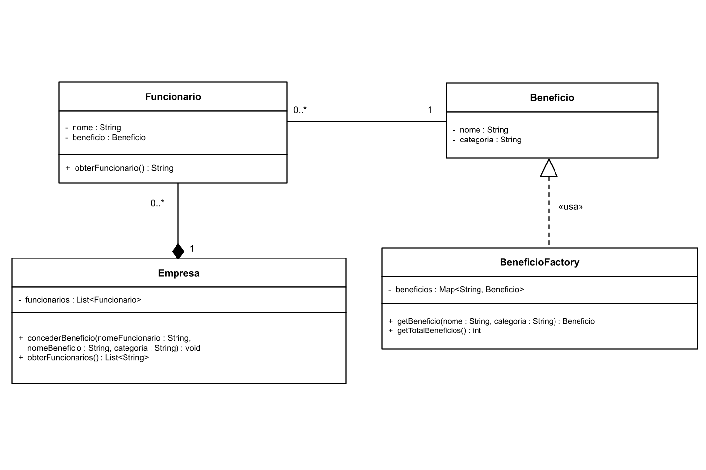

# Padrão de Projeto: Flyweight (Sistema de RH)

Projeto em Java exemplificando a aplicação do padrão estrutural **Flyweight** no contexto de um sistema de benefícios de Recursos Humanos para a disciplina DCC078-2026.3-A - Aspectos Avançados em Engenharia de Software.

## Diagrama de Classes UML

## Padrão Utilizado

O padrão **Flyweight** é utilizado para compartilhar objetos que possuem informações comuns, evitando a criação de várias instâncias com os mesmos dados e reduzindo o consumo de memória.

Neste projeto, o padrão foi aplicado ao compartilhamento dos tipos de benefícios oferecidos pela empresa. Funcionários que recebem o mesmo benefício utilizam a mesma instância da classe `Beneficio`, enquanto suas informações individuais permanecem armazenadas na classe `Funcionario`.

A classe `BeneficioFactory` controla a criação e o compartilhamento dos objetos, reutilizando instâncias já existentes.

## Estrutura

- `Funcionario`: representa o funcionário, armazenando seu nome e uma referência ao benefício recebido.
- `Beneficio`: representa o objeto compartilhado (*Flyweight*), contendo o nome e a categoria do benefício.
- `BeneficioFactory`: controla a criação e o compartilhamento dos benefícios por meio de um `HashMap`, evitando instâncias duplicadas.
- `Empresa`: gerencia os funcionários e disponibiliza os métodos para conceder benefícios e obter a relação de funcionários.
- `EmpresaTest`: classe de testes para verificar os funcionários cadastrados e a quantidade de tipos de benefícios criados.

## Testes

Os testes verificam:

- cadastro de funcionários com diferentes benefícios;
- reutilização dos benefícios compartilhados entre funcionários;
- quantidade total de tipos de benefícios registrados na fábrica.